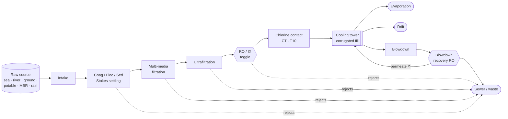

# Cooling Water M&E Engine

**Data Center Cooling Water Management — Monitoring & Evaluation System**

[](https://www.python.org/)
[](LICENSE)
[](https://streamlit.io/)
[](tests/)

This is an open-source engineering model for the water side of data-center cooling. It follows raw water through a
toggleable treatment train into an evaporative cooling tower and an optional blowdown-recovery loop. At every node it
enforces flow and species mass balances. It quantifies scaling risk, microbial risk (CT and QMRA), pump and fan
energy, and the lifecycle cost of upgrades such as **corrugated-sheet fill, high-efficiency drift eliminators, and
high cycles of concentration**.

The engine has three front ends:

| Front end | What you get |
|---|---|
| **Python engine** (`src/engine`) | Typed, tested modules you can script, extend, or embed. |
| **Excel workbook** (`build_cooling_me_engine.py`) | `Data_Center_Cooling_ME_Engine.xlsx` with every result as a **live formula**: edit a yellow input and the whole model recalculates, including the Merkel fill solver, NPV and IRR. |
| **Streamlit dashboard** (`app.py`) | Interactive process builder, Plotly Sankey water balance, corrugated-fill simulator, scenario comparison, and one-click Excel export. |

The Excel formulas and the Python engine implement the same equations. A test recalculates the workbook and checks
the Python results to within 0.1% (observed worst case: 3×10⁻⁵, from the Merkel interpolation grid).

---

## Quickstart

```bash
git clone https://github.com/albertpowa/cooling-water-me-engine.git
cd cooling-water-me-engine
python3 -m venv .venv && source .venv/bin/activate      # Windows: .venv\Scripts\activate
pip install -r requirements.txt

streamlit run app.py                                   # interactive dashboard
python build_cooling_me_engine.py                      # → Data_Center_Cooling_ME_Engine.xlsx
python build_cooling_me_engine.py --source mbr_permeate --ro --it-mw 20 -o reuse.xlsx
python examples/run_sample_simulation.py               # programmatic use
pytest                                                 # test suite (pip install -r requirements-dev.txt for the Excel parity test)
```

If you only want the spreadsheet, a pre-built sample is at
[`examples/Data_Center_Cooling_ME_Engine.xlsx`](examples/Data_Center_Cooling_ME_Engine.xlsx).

### Use it from Python

```python
from src.engine import load_config, compare_scenarios, run_scenario
from src.excel.exporter import export_workbook

cfg = load_config({"site": {"source": "river_water"},
                   "treatment": {"ro": {"enabled": True}},
                   "scenarios": {"optimized": {"coc_target": 8}}})
c = compare_scenarios(cfg)
print(c.optimized.intake_gpd, c.optimized.tower.coc, c.finance.npv)
export_workbook(cfg, "river_case.xlsx")
```

Every input lives in [`config/design_defaults.yaml`](config/design_defaults.yaml) and
[`config/water_source_profiles.yaml`](config/water_source_profiles.yaml). `load_config(overrides)` deep-merges any
subset of them.

---

## Architecture & process flow



```
cooling-water-me-engine/
├── app.py                         # Streamlit entry point
├── build_cooling_me_engine.py     # Excel builder CLI
├── config/
│   ├── water_source_profiles.yaml # 6 source matrices, dose-response, LEED limits
│   └── design_defaults.yaml       # 50 MW NYC case, nodes, fill, pumps, tariffs
├── src/
│   ├── engine/
│   │   ├── water_quality.py       # LSI / RSI, silica alert, CoC limits
│   │   ├── mass_balance.py        # node balances, train sizing, tower + BD-RO loop
│   │   ├── thermodynamics.py      # heat load, COP, evaporation, Merkel fill model
│   │   ├── microbiology_qmra.py   # CT, LRT/LRV, Beta-Poisson & exponential QMRA
│   │   ├── hydraulics.py          # WHP/BHP/kW, HI 9.6.3 POR, induced-draft fan
│   │   ├── economics.py           # PV, NPV, IRR, BEP, SPBT
│   │   ├── scenario.py            # orchestrator: one scenario / Baseline vs Optimized
│   │   ├── constants.py · config.py
│   ├── excel/exporter.py          # openpyxl live-formula workbook
│   └── ui/app.py                  # Streamlit + Plotly dashboard
├── tests/                         # pytest, anchored to worked examples
└── examples/run_sample_simulation.py
```

**How the solve works.** Node doses are expressed in mg/L of node inflow, so treated-water quality does not
depend on the flow rate. The engine therefore runs in a fixed order with no iteration:

1. Compute the treated makeup quality.
2. Run the fill model and the heat balance.
3. Find the cycles-of-concentration limits.
4. Solve the tower and blowdown-recovery loop in closed form.
5. Size the treatment train backwards from the fresh makeup flow.
6. Evaluate risk, energy and cost.

The workbook follows the same order, so Excel has no circular references.

---

## Mathematical formulation

US customary units are primary (8.34 lb/gal, 970 BTU/lb). SI and WUE are reported alongside.

### Mass balance (every node)

$$Q_{out} = Q_{in} - Q_{reject} - Q_{evap} \qquad C_{out,j} = \frac{Q_{in}C_{in,j}(1-R_j) + \text{Dosing}_j}{Q_{out}} \qquad C_{waste,j} = \frac{Q_{in}C_{in,j}R_j}{Q_{reject}}$$

$R_j$ is the **mass** fraction of species $j$ sent to the waste stream. For membranes, the rejection
$\text{rej} = 1 - C_p/C_f$ converts as $R_j = 1 - Y(1-\text{rej}_j)$. The model tracks 15 physico-chemical parameters
(pH, EC, TDS, SiO₂, Na, Ca, Mg, Cl, PO₄, SO₄, alkalinity, free Cl₂, TSS, BOD₅, COD) and 7 biological ones.

### Heat rejection

$$Q_{cooling} = \dot m\,c_p\,\Delta T,\ \ \dot m = Q_{gpm}\cdot 8.34\cdot 60 \qquad \text{TL} = Q_{cooling}\left(1+\tfrac{1}{COP}\right) \qquad E_{gph} = \frac{\text{TL}}{970\times 8.34}$$

$$Q_{recirc} = \frac{\text{TL}}{500\cdot\text{Range}} \qquad D = f_{drift}\,Q_{recirc}$$

### Cycles of concentration, blowdown and makeup

Drift is an uncontrolled bleed at recirculating concentration. With optional blowdown recovery
(recovery $Y$, brine mass fraction $k = 1 - Y(1-\text{rej})$) and system cycles $N = C_r/C_f$:

$$B = \frac{E - (N-1)D}{N k - 1 + Y} \qquad M_f = E + D + B(1-Y) \qquad C_{r,j} = \frac{M_f\,C_{f,j}}{D + B k_j}$$

With no recovery and negligible drift this reduces to the familiar $B = E/(CoC-1)$ and $M = E\cdot CoC/(CoC-1)$.
The workbook shows that course check next to the exact result.

The operating CoC is the minimum of:

- the user target (2–10);
- the LEED v4 Table 1 limits (Ca as CaCO₃ 1000, alkalinity 1000, SiO₂ 100, Cl⁻ 250 ppm, EC 2000 µS/cm);
- the LSI ceiling, solved in closed form: $N_{LSI} = 10^{(LSI_{max} - pH_r + pH_{s1})/1.9}$;
- the drift limit $N \le 1 + E/D$.

The binding constraint is flagged.

> **Why drift matters.** At a fixed CoC, cutting drift from 0.2% to 0.001% does not reduce makeup, because the
> controller bleeds that water as blowdown instead. The model shows this with a "fill only" attribution case. The
> water savings come because high-efficiency eliminators **raise the drift ceiling on CoC** (≈6 → >1000 cycles in
> the default case), which makes a high-CoC strategy possible. The upgrade also cuts Legionella aerosol exposure
> about 200-fold.

### Scaling indices

$$LSI = pH - pH_s,\quad pH_s = (9.3 + A + B) - (C + D),\quad RSI = 2pH_s - pH$$

where $A=(\log TDS-1)/10$, $B=-13.12\log(T_{°C}+273)+34.55$, $C=\log(\text{Ca as CaCO}_3)-0.4$ and
$D=\log(\text{Alk})$. A silica blowdown alert triggers above 150 mg/L.

### Corrugated fill (Merkel)

$$\left.\tfrac{KaV}{L}\right|_{avail} = c_0\frac{SSA}{SSA_{ref}}\frac{H}{H_{ref}}\left(\frac{\theta}{30°}\right)^{a}\left(\frac{L}{G}\right)^{-n} \qquad \left.\tfrac{KaV}{L}\right|_{req} = \frac{\text{Range}}{4}\sum_{i=1}^{4}\frac{1}{h_{sat}(T_i)-h_{a,i}}$$

The solver finds the cold-water temperature where required equals available (Chebyshev points at 0.1, 0.4, 0.6 and
0.9 of the range). Colder condenser water raises the chiller COP:
$COP = COP_{ref}[1 + s(T_{ref}-T_{cw})]$, which lowers tower load and evaporation. The fill pressure drop is
$\Delta P = c\,SSA\,H\,\tfrac12\rho v^2(\theta/30°)^{b}/\varepsilon^2$ with open area
$\varepsilon = 1 - SSA\cdot t/2$, and it feeds the fan power.

> A better fill **cannot increase evaporation** for a fixed heat load, because the energy balance fixes it. All
> fill benefits come through approach → COP → tower load, and they are reported net of the extra fan energy.

### Hydraulics

$$WHP=\frac{Q\,TDH}{3960}\quad BHP=\frac{WHP}{\eta_h}\quad P_{kW}=\frac{0.7457\,BHP}{\eta_m\eta_e}\quad N=\left\lceil\frac{Q}{Q_{BEP}}\right\rceil$$

The HI 9.6.3-2017 preferred operating range is $0.7\,Q_{BEP}$ to $1.2\,Q_{BEP}$ per pump. Fan power is
$V_{air}\Delta P/(\eta_f\eta_m)$, with $V_{air}$ derived from $L/G$.

### Disinfection & QMRA

$$CT = C\cdot T_{10},\ T_{10}=TDT\cdot BF,\ TDT=V/Q_{peak} \qquad LRT=\log_{10}\frac{C_{in}}{C_{target}}$$

$$P_d^{BP}=1-\left(1+\tfrac{d}{\beta}\right)^{-\alpha},\quad P_d^{exp}=1-e^{-rd},\quad P_y=1-(1-P_d)^n \le 10^{-4}$$

- **Chlorine credits.** Inactivation credit = target log × $CT/CT_{req}$, with $CT_{req}$ taken from the SWTR
  Guidance Manual tables (4-log virus; 3-log Giardia at pH 7).
- **Ingestion pathogens.** Rotavirus (α 0.253, β 0.422) and *V. cholerae* (α 0.097, β 13,020) use Beta-Poisson;
  Giardia (r 0.0199) and Cryptosporidium (r 0.0042) use the exponential model. Each is credited with the
  treatment-train LRVs.
- **Legionella.** Modelled as an **inhalation** risk from drift aerosol (exponential, r = 0.06). Legionella regrows
  in the basin, so exposure starts from the recirculating control level, not the treated makeup.

### Economics

$$i=r_{int}+r_{inf}\quad PV=\frac{FV}{(1+i)^n}\quad NPV=\sum_{t=1}^{N}\frac{CF_t}{(1+i)^t}-CapEx\quad SPBT=\frac{CapEx}{\text{Annual savings}}$$

BEP is the interpolated year in which cumulative discounted cash flow crosses zero. IRR is solved by bisection in
Python and with `IRR()` in Excel. Annual cost covers water, sewer, electricity, chemicals, sludge and the social
cost of carbon.

---

## Default design case (50 MW IT, New York City)

| KPI | Current Baseline | Corrugated Fill + High CoC |
|---|---:|---:|
| Approach / chiller COP | 9.5 °F / 5.44 | 5.3 °F / 5.91 |
| Cycles of concentration | 4.0 | 10.0 (with blowdown-recovery RO) |
| Raw water intake | 928,837 gpd | 710,186 gpd |
| Drift | 122,046 gpd | 603 gpd |
| WUE | 2.93 L/kWh | 2.24 L/kWh |
| PUE | 1.316 | 1.305 |
| Legionella inhalation risk Pᵧ | 5.2×10⁻² | 2.7×10⁻⁴ (0.43-log more control needed) |
| LEED v4 WE cooling-tower points | 0 | 2 |

The upgrade costs about $0.62M (fill, eliminators, blowdown RO, installation) and pays back in about 0.4 years,
with an NPV of $11.7M over 10 years at i = 7%. These are screening numbers: see the assumptions below.

## Data sources & references

- Water-balance, CT, QMRA, pumping and economics methods follow the EAEE 4163 *Sustainable Water Treatment & Reuse*
  coursework and its worked examples. The unit tests reproduce several of them: the rotavirus LRT of 8.5, the
  52,000 gpd tower midterm, the chlorine CT example, the Week 10 pump power and the LEED reference-guide CoC table.
- **Tariffs**: NYC DEP Water & Wastewater Rate Schedule FY2022. Water is $4.10 per 100 ft³, sewer is 159% of the
  water charge, and the cooling-tower wastewater allowance exempts evaporation.
- **LEED v4 BD+C** WE Credit *Cooling Tower Water Use*, Tables 1–2.
- **USEPA SWTR Guidance Manual**: CT tables for free chlorine.
- **WERF**, *Risk-Based Framework for Development of Public Health Guidance for Decentralized Non-Potable Water
  Systems*: exposure volumes and frequencies.
- Dose-response parameters: Haas, Rose & Gerba, *Quantitative Microbial Risk Assessment*; Armstrong & Haas (2007)
  for Legionella.
- **Hydraulic Institute HI 9.6.3-2017**: preferred operating range.

## Assumptions & limitations

Read these before using the results for design:

- Source water matrices are representative screening values. Replace them with laboratory data.
- These are calibrated screening correlations, not vendor data. Calibrate them to the manufacturer's tower
  characteristic curve and pressure-drop data:
  - fill thermal model ($c_0$, exponents) and fill pressure-drop coefficient;
  - COP sensitivity of about 2% per °F;
  - RO energy correlation of 0.3 + 0.1·TDS kWh/m³.
- Evaporation assumes all heat is rejected latently, as in the course method. That is conservative: real towers are
  about 75–85% latent.
- Annual values are design-day rates × hours × utilization. There is no weather-bin or free-cooling simulation.
- The receptor dilution and respirable fraction in the Legionella model are screening assumptions.
- Pathogens are not concentrated by cycles, because of die-off and the chlorine residual. Legionella regrowth is
  represented by the control level you enter.

## Contributing

Contributions are welcome: new treatment nodes, weather-bin annualization, vendor fill curves, additional
dose-response models, and localization of tariffs.

1. Fork the repo, then create a branch: `git checkout -b feature/my-node`.
2. Keep the design rules:
   - physics belongs in `src/engine`, as pure, typed functions with docstrings that show the equation;
   - inputs belong in YAML, not in code;
   - any new formula must exist in **both** the engine and the exporter.
3. Add tests. Anchor new physics to a worked example or published value, and extend `test_excel_exporter.py` if
   you touch the workbook.
4. Run `pip install -r requirements-dev.txt && pytest && python -m pyflakes src tests`.
5. Open a pull request describing the engineering basis and its references.

Style: PEP 8, 120-character lines, `from __future__ import annotations`, Python 3.9+ compatible.

## License

[MIT](LICENSE)
